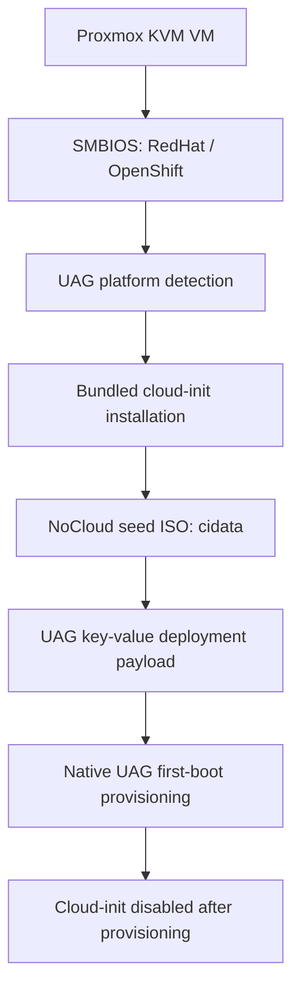

# UAG on Proxmox — Community Lab PoC v0.2.2

**Experimental / LAB ONLY / NOT officially supported by Omnissa.** Independent community experiment, not an Omnissa product or production deployment recommendation. No warranty or support is provided. Do not use on Internet-facing or production systems. Check vendor licensing and support terms before use.

## What was observed

On Proxmox VE 9.2.2 with UAG 26.09.1, a fresh original QCOW2 booted with CPU host, SeaBIOS, VirtIO SCSI single, one VirtIO NIC, and SMBIOS manufacturer=RedHat,product=OpenShift. The appliance detected KVM and the OpenShift DMI string, installed its bundled cloud-init package, read the NoCloud seed, applied the UAG settings and disabled cloud-init after provisioning. Root console and admin UI login worked, static IPv4 persisted after reboot, and no systemd units were failed after reboot. Admin and esmanager processes were running. No Edge Services were configured or tested. Initial boot had logrotate and systemd-firstboot errors which were absent after reboot. SSH root access was separately modified for troubleshooting and is NOT part of this tool.

This release reconstructs the successful manual procedure using the earlier prototype. The Python dry-run was tested; the revised package itself has not been end-to-end tested on a real host. No support, security, FIPS/NIAP, upgrade, HA or multi-NIC compatibility claim is made. SMBIOS identification is deliberately changed for the experiment; this does not make Proxmox an OpenShift platform.

## Key mechanism: SMBIOS platform identification (required before first boot)

The initial generic KVM test did not provision correctly: UAG selected its AWS-related initialization path rather than OpenShift. The successful test used a fresh QCOW2 and deliberately supplied OpenShift DMI identification through Proxmox SMBIOS Type 1. This is the central experimental workaround, not an OpenShift installation or a supported platform conversion.

| SMBIOS field | Required value for this experiment |
| --- | --- |
| Manufacturer | `RedHat` |
| Product | `OpenShift` |

`deploy.py` automatically includes the following arguments in `qm create`:

```python
'--smbios1', 'manufacturer=RedHat,product=OpenShift'
```

For a manually created, stopped VM with a fresh, never-booted UAG disk, the equivalent command is:

```bash
qm set 901 --smbios1 manufacturer=RedHat,product=OpenShift
qm config 901 | grep '^smbios1:'
```

Expected configuration:

```text
smbios1: manufacturer=RedHat,product=OpenShift
```

If the VM already has other SMBIOS fields (such as a UUID), preserve them when changing the configuration. In the Proxmox UI, the corresponding setting is VM > Options > SMBIOS settings (type1). Set Manufacturer and Product, then verify with `qm config`.

**Do this before the first boot.** Changing SMBIOS after a failed provisioning attempt is not equivalent to starting with a clean disk. Do not reset first-boot flags to retry; import a fresh original QCOW2 into a new disposable VM instead.

The observed initialization sequence was:



After boot, verify inside the appliance:

```bash
systemd-detect-virt
dmidecode -s system-manufacturer
dmidecode -s system-product-name
dmesg | grep -i openshift
```

Expected: `kvm`, `RedHat`, `OpenShift`, and a kernel DMI line containing `RedHat OpenShift`. This identification alone is not proof of successful provisioning; complete the validation below. In the successful test, the NoCloud datasource was `/dev/sr0`, and the native UAG mechanism applied the settings and disabled cloud-init afterward.

## Prerequisites

- Disposable isolated lab, Proxmox VE 9.2.2, Python 3, root on node, adequate RAM and storage.
- Original UAG 26.09.1 standalone QCOW2 and matching Omnissa deployment bundle obtained separately from the vendor. Neither is redistributed here.
- Trusted Windows workstation with PowerShell and original extracted `uagdeploy.psm1` (keep vendor bundle intact).
- Isolated bridge (example vmbr10), storage supporting VM images/cloud-init and directory storage supporting snippets. Verify IP uniqueness before boot. Example IPs are documentation-only and must be replaced.

## 0. Prepare the lab (Proxmox shell)

Run these commands as root. The example assumes an existing isolated `vmbr10` bridge; create it in Node > System > Network if absent, with no physical ports or uplink. Do not change the management bridge.

```bash
pveversion
python3 --version
pvesm status
qm list
free -h
ip -br link
ip link show vmbr10
install -d -m 700 /root/uag-deploy
```

Enable snippets on `local` via Datacenter > Storage > local > Edit, retaining all existing content types. The following CLI example is only for a storage whose existing content types are exactly `iso,vztmpl,backup`; otherwise preserve the actual list and append `snippets`.

```bash
cat /etc/pve/storage.cfg
pvesm set local --content iso,vztmpl,backup,snippets
mkdir -p /var/lib/vz/snippets
```

## 1. Generate seed on workstation

Open PowerShell in the extracted repository directory (example below; adjust paths). Keep the vendor bundle extracted separately.

```powershell
Set-Location C:\Temp\uag-proxmox-lab
Get-ChildItem -Force
Test-Path C:\uagdeploy\uagdeploy.psm1
notepad .\uag-lab.ini
```

Edit `uag-lab.ini` for your isolated network. Keep one NIC and SSH disabled. Use a private directory with restrictive Windows ACLs before generating the file. Enter unique lab passwords meeting UAG complexity requirements when prompted.

```powershell
.\New-UagUserData.ps1 -IniFile .\uag-lab.ini -VendorModule C:\uagdeploy\uagdeploy.psm1 -OutputFile .\uag-901.yaml
```

The script calls the vendor module to produce settingsJSON and wraps the key/value data in NoCloud YAML, writing to `/var/lib/cloud/instances/user-data.txt`. Vendor escaping is preserved. This is a limited generator, not a replacement for all vendor validation. The YAML contains plaintext secrets. Never commit it, print it, or share it. Use encrypted transfer to a private root-owned directory on the Proxmox host.

### Transfer files (Windows PowerShell)

Replace `pve-lab` with the actual Proxmox hostname or IP and the QCOW2 path with your downloaded image. Verify the SSH host key. The target private directory must already exist (step 0).

```powershell
scp .\deploy.py .\uag-901.yaml root@pve-lab:/root/uag-deploy/
scp C:\uagdeploy\uag.qcow2 root@pve-lab:/root/uag-deploy/uag.qcow2
```

## 2. Deploy on Proxmox

Enable snippets on the chosen directory storage using the Proxmox UI, preserving existing content types. Example assumes `local` maps to `/var/lib/vz` and `local-lvm` supports disks. Transfer deploy.py, YAML and QCOW2 separately to `/root/uag-deploy`.

```bash
chmod 700 /root/uag-deploy
mkdir -p /var/lib/vz/snippets
install -m 600 /root/uag-deploy/uag-901.yaml /var/lib/vz/snippets/uag-901.yaml
cd /root/uag-deploy
chmod 600 uag-901.yaml
qemu-img info uag.qcow2
qemu-img check uag.qcow2
pvesm path local:snippets/uag-901.yaml
python3 deploy.py --vmid 901 --name uag-lab --image /root/uag-deploy/uag.qcow2 --storage local-lvm --snippet local:snippets/uag-901.yaml --nic vmbr10
```

Default is dry-run. Review the commands and repeat with `--apply` to create a stopped VM. Existing VMIDs are refused. No automatic rollback/deletion; inspect partial deployments before cleanup. Review `qm config 901` and confirm `smbios1: manufacturer=RedHat,product=OpenShift` before first boot, ensure the bridge is isolated, then `qm start 901`. Do not reuse a previously initialized disk. `--start` is optional with `--apply` but manual start is preferred. Do not run two appliances with the same IP.

### Apply and inspect before first boot

```bash
python3 deploy.py --vmid 901 --name uag-lab --image /root/uag-deploy/uag.qcow2 --storage local-lvm --snippet local:snippets/uag-901.yaml --nic vmbr10 --apply
qm config 901
qm config 901 | grep '^smbios1:'
qm start 901
```

### Alternative: complete manual deployment (without Python)

Use this instead of the Python deployment, not in addition to it. VMID 901 must be unused cluster-wide; the seed must already exist as above. The following commands reproduce the observed successful VM settings.

```bash
qm create 901 --name uag-lab --cores 2 --memory 4096 --cpu host --bios seabios --scsihw virtio-scsi-single --ostype l26 --agent 1 --net0 virtio,bridge=vmbr10 --smbios1 manufacturer=RedHat,product=OpenShift
qm set 901 --scsi0 local-lvm:0,import-from=/root/uag-deploy/uag.qcow2
qm set 901 --ide2 local-lvm:cloudinit --citype nocloud --cicustom user=local:snippets/uag-901.yaml --boot order=scsi0
qm cloudinit update 901
qm config 901
qm config 901 | grep '^smbios1:'
```

Optional seed verification before starting (specific to the example LVM-thin storage):

```bash
mkdir -p /mnt/uag-cloudinit
mount -t iso9660 -o ro /dev/pve/vm-901-cloudinit /mnt/uag-cloudinit
cmp -s /mnt/uag-cloudinit/user-data /var/lib/vz/snippets/uag-901.yaml && echo MATCH || echo MISMATCH
umount /mnt/uag-cloudinit
qm start 901
```

Do not start if the comparison reports MISMATCH or mounting fails. Do not print user-data. The block device path is storage-specific; verify it first with `qm config 901` and `pvesm path local-lvm:vm-901-cloudinit`.

## 3. Validate in console

```bash
systemd-detect-virt
dmidecode -s system-product-name
rpm -q cloud-init
cloud-init status --long
ip -br a
ip route
systemctl --failed --no-pager
supervisorctl status
ls -l /opt/omnissa/root/conf/firstboot.flag
wc -c /opt/omnissa/gateway/conf/firstboot_error
ss -lnt
```

Expected: kvm, OpenShift, cloud-init installed and disabled by marker after successful provisioning, configured IPv4, firstboot flag and empty firstboot_error. Validate root console login and admin login at `https://<lab-ip>:9443/admin/` from an authorized lab client. Verify certificate identity before entering credentials. Reboot and repeat checks. A disabled health status with no Edge Services configured is not proof of a healthy production gateway. Do not enable cloud-init again or reset firstboot flags blindly.

## 4. Reboot and verify persistence

From the appliance console:

```bash
reboot
```

After logging back in through the console:

```bash
hostname
uptime
ip -br a
ip route
systemctl --failed --no-pager
supervisorctl status
cloud-init status --long
ss -lnt
```

From the Proxmox node:

```bash
qm status 901
qm agent 901 ping
qm agent 901 network-get-interfaces
```

Repeat Admin UI login from an authorized client on the isolated lab network. If provisioning fails, collect local diagnostics without publishing unredacted logs:

```bash
journalctl -b -u uag_sysconfig.service --no-pager
journalctl -b -u logrotate.service --no-pager
journalctl -b -u systemd-firstboot.service --no-pager
```

## Security and cleanup

Do not enable root SSH/password authentication merely to run these checks; use console. Restrict management access, rotate lab passwords, and protect seed ISO, snippets, backups and cloud-init caches as sensitive. After validation, assess seed detachment on a disposable VM and remove redundant secret copies securely (thin storage and backups may retain data). Do not delete guest provisioning files without understanding their lifecycle. Do not publish vendor binaries, modules, logs, credentials or real configuration. No FIPS or security integrity checks were bypassed by these scripts.

## Files

- `New-UagUserData.ps1`: workstation seed generator using the separately obtained vendor module.
- `deploy.py`: Proxmox VM creation, import and NoCloud attachment, dry-run by default.
- `uag-lab.ini`: example one-NIC IPv4 configuration.
- `.gitignore`: excludes common secret and vendor artifacts; review every commit manually.

Source observation: the supplied vendor OpenShift deployment script uses cloudInitNoCloud and the plural `/var/lib/cloud/instances/user-data.txt` path. No vendor source is included. All product names belong to their respective owners.
